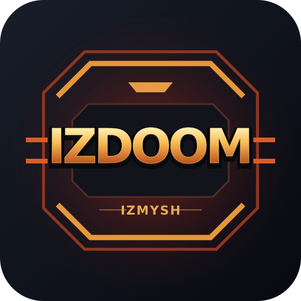

# IZDOOM 0.17.1

**IZDOOM is a homebrew port of DOOM for NS2 (Nintendo Switch 2).**

An unofficial DOOM-derived GPU port for the [IZ2W / IZ2S Platform](https://github.com/byizmysh/IZ2S-Platform), by IZMYSH contributors.

Game logic runs in an RV32 interpreter on the console GPU; shaders render the world, sprites, HUD and transitions. Sound effects and music are not yet implemented. The ordinary IZ2W platform is still required to load and run the module.

## Downloads and installation

- **IZ2S build (.izm):** download `IZDOOM-v0.17.1-IZ2S.izm` from [Releases](https://github.com/byizmysh/IZDOOM/releases/tag/v0.17.1) and follow [INSTALL-IZ2S.md](INSTALL-IZ2S.md). Game data is included; no separate data file or compiler is required.
- **Исходники / Sources:** download the source archive from the same release and follow [BUILD-FROM-SOURCE.md](BUILD-FROM-SOURCE.md). Complete engine, shader and build sources, the icon, licenses and original episode-one game data are included.

## Licensing and data

IZDOOM remains a DOOM-derived port, not a clean-room original game. The combined source is distributed under GPL version 2; component notices and additional grants are described in LICENSE-SCOPE.md, NOTICE.md and docs/LICENSING.md. A standalone GitHub repository may be used with the required notices and complete corresponding source; GitHub's Fork button is not a license requirement.

Both the source archive and ready-to-load IZ2S module include the original DOOM shareware v1.9 first-episode data under its separate terms. See [LICENSES/DOOM1-SHAREWARE.txt](LICENSES/DOOM1-SHAREWARE.txt) for the license and redistribution clarification. Retail DOOM data is not included.

This is an unofficial project, not endorsed by id Software.
